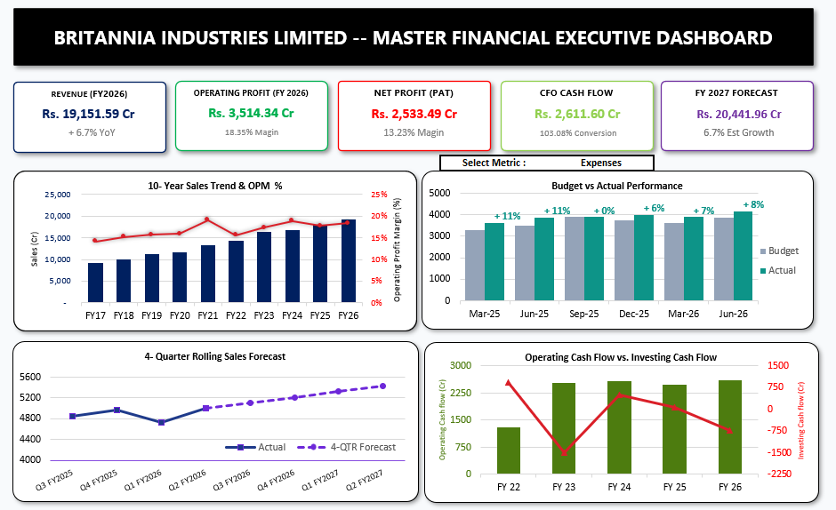
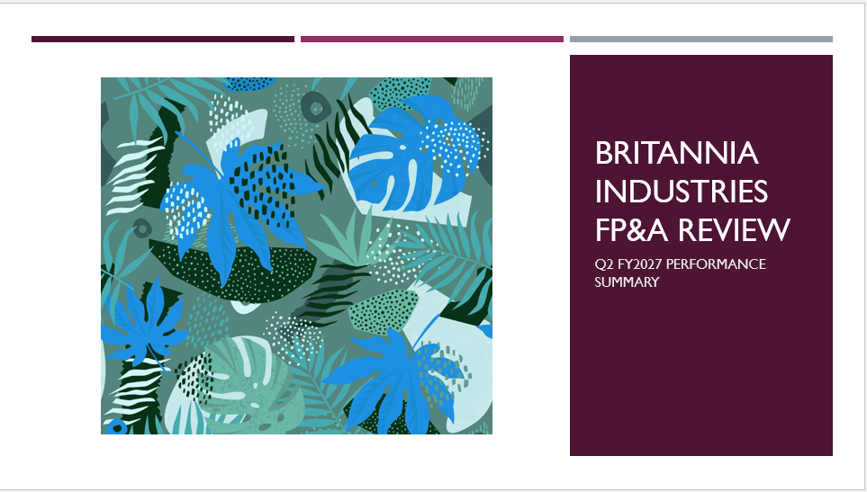

# Britannia Industries — FP&A Reporting Dashboard

End-to-end FP&A portfolio project: budget-vs-actual variance analysis, 
rolling forecast, and cash flow tracking for Britannia Industries Ltd., 
built in Excel (Power Query + DAX-style dynamic formulas) and Power BI, 
with a management-ready PowerPoint summary.

## Live Demo

## Overview

- **Data source:** Britannia Industries public financials (Screener.in), 
  10 years annual + 10 quarters (Mar-24 to Jun-26)
- **Tools:** Excel (Power Query, XLOOKUP, OFFSET, Data Validation + IFS), 
  Power BI (DAX measures, star-schema model), PowerPoint
- **Key findings:** [1-2 lines — e.g. "Operating margin expanded 65bps 
  in FY2026, driven by input cost stabilization and cost discipline"]

## Project Structure

| Folder | Contents |
|---|---|
| `excel/` | Full Excel model — budget vs actual, forecast, commentary |
| `powerbi/` | Interactive Power BI dashboard (.pbix) |
| `powerpoint/` | 6-slide management presentation |

## Excel Dashboard

## PowerPoint Summary

## Skills Demonstrated

Budget vs actual variance analysis, rolling forecast modeling, Power Query 
data transformation, DAX measures, star-schema data modeling, management 
reporting and presentation design.